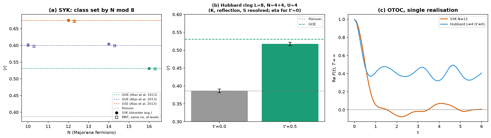

# Quantum Chaos Framework

Exact-diagonalisation and small-circuit tools for quantum chaos and information
scrambling in the Sachdev–Ye–Kitaev (SYK) model and the Hubbard chain:
symmetry-resolved level statistics checked against random-matrix theory,
infinite- and finite-temperature OTOCs (exact and as a Hadamard-test circuit),
Floquet quasi-energies, Trotter circuits with a physical T1/T2 noise model, and
Hamiltonian-encoding quantum kernels.

[](https://www.python.org/downloads/)
[](https://opensource.org/licenses/MIT)

## Status

Version `0.2.0.dev0`, under active correction and validation — see
[PLAN.md](PLAN.md) for the full plan and [VALIDATION.md](VALIDATION.md) for what
has been tested, the results, and what is not yet verified.

- Phase 0 (bug fixes) and phase 1 (spectral statistics) are complete.
- Packaging/CI/docs (phase 2) and research features such as spectral form
  factor, Lyapunov exponents, Krylov complexity and higher-order Floquet
  expansions (phase 3) are **not** done yet.

## Installation

```bash
git clone https://github.com/rasidi3112/quantum-chaos-framework.git
cd quantum-chaos-framework
pip install -e ".[test]"
pytest                 # fast suite (~25 s)
pytest -m slow         # long statistical tests
```

Requires Python ≥ 3.11 and PennyLane 0.45.x (pinned), NumPy, SciPy,
Matplotlib and scikit-learn.

## Quick start

```python
from quantum_chaos.hamiltonians import SYKHamiltonian, hubbard_level_statistics
from quantum_chaos.hamiltonians.syk_hamiltonian import disorder_average_lsr, syk_rmt_reference

# One SYK realisation: symmetry class from N mod 8, sector-resolved <r>
syk = SYKHamiltonian(n_majorana=14, seed=1)
print(syk.symmetry_class, round(syk.get_level_spacing_ratio(), 4))

# Disorder average vs. random-matrix theory with the same number of levels
stats = disorder_average_lsr(14, n_realizations=100, rng=0)
ref = syk_rmt_reference(14, n_samples=500, rng=1)
print(
    f"<r> = {stats['mean']:.4f} ± {stats['stderr']:.4f}  (RMT {ref['mean']:.4f}, "
    f"large-N {stats['reference']:.4f})"
)

# Hubbard ring, fully symmetry resolved: integrable (t'=0) vs t'=0.5
for tp in (0.0, 0.5):
    res = hubbard_level_statistics(n_sites=8, n_up=4, n_down=4, tp=tp, U=4.0)
    print(f"t'={tp}: <r> = {res['mean']:.4f} ± {res['stderr']:.4f}")
```

Output (macOS, Python 3.13, NumPy 2.5.4):

```
GUE 0.6502
<r> = 0.6010 ± 0.0034  (RMT 0.5992, large-N 0.5996)
t'=0.0: <r> = 0.3863 ± 0.0053
t'=0.5: <r> = 0.5173 ± 0.0048
```

`python main.py` prints a longer demonstration and regenerates the figure
below (~30 s). `make figures` regenerates every figure from the YAML files in
`configs/figures/` (seeds included), each with a JSON sidecar holding the
plotted numbers and provenance; `make validate` regenerates the validation
tables (~40 min).



*(a) SYK ⟨r⟩ per N (filled) and random matrices with the same number of levels
(open), with the large-N values of Atas et al.; the class follows N mod 8.
(b) Hubbard ring L=8, N=4+4, U=4: integrable t'=0 vs t'=0.5 (at L=8 still
below GOE; L=10 results in VALIDATION.md). (c) Infinite-
temperature OTOC of one realisation (qualitative).*

## Conventions

- **SYK:** H = Σ_{i<j<k<l} J_ijkl χ_i χ_j χ_k χ_l with ⟨J²⟩ = 3! J²/N³. The
  Majoranas are Jordan–Wigner Pauli strings with χ² = 1; Maldacena–Stanford and
  Cotler et al. use {χ_a, χ_b} = δ_ab (χ² = ½), whose Hamiltonian is H/4 —
  use `SYKHamiltonian(..., chi_squared=0.5)` when comparing energies.
- **Symmetry classes (per fermion-parity sector):** GOE for N mod 8 = 0, GUE
  for 2 and 6 (the two sectors are then degenerate), GSE for 4 (Kramers pairs
  inside each sector, one level per pair is kept). Spectra of different
  sectors are never merged, and no "small spacing" filter is applied.
- **Hubbard ring:** H = −t Σ (c†_{j+1}c_j + h.c.) − t′ Σ (c†_{j+2}c_j + h.c.) +
  U Σ n_{j↑}n_{j↓} with periodic boundary conditions; levels are resolved by
  N↑, N↓, momentum, reflection (K = 0, π), total spin and — for t′ = 0 and even
  L — η-spin.
- **Noise:** T1/T2 relaxation with 1/T_φ = 1/T2 − 1/(2T1) for the physical
  duration of each step; depolarizing error ρ → (1−p)ρ + p I/2 per gate layer
  (PennyLane parameter 3p/4).

## Validation summary

Full tables, tolerances and open items: [VALIDATION.md](VALIDATION.md).

| Check | Result |
|---|---|
| SYK ⟨r⟩, N = 10…22, all three classes | agrees with same-size RMT, \|z\| ≤ 1.1 |
| Particle-hole operator P: [P,H]=0, P² = (−1)^{n(n−1)/2} | exact (1e-12) |
| Hubbard ED: U=0 free fermions, t=0 limit, union of blocks, JW cross-check | exact (1e-10) |
| Hubbard ring L=10, N=5+5, U=4: t′=0 vs t′=0.5 | 0.3857(14) vs 0.5287(13): Poisson 0.3863 vs GOE 0.5307 (−1.5σ); smaller/dilute sectors still below GOE |
| OTOC Hadamard-test circuit vs exact OTOC | 1e-8 |
| Noise model: \|ρ01\| ∝ exp(−t/T2), P1 ∝ exp(−t/T1) | 1e-10 |

## Limitations (honest list)

- System sizes are those of exact diagonalisation on a laptop (SYK N ≤ 24,
  Hubbard L ≤ 10); no claim is made about the thermodynamic limit.
- For the non-integrable Hubbard ring (t′ = 0.5), ⟨r⟩ is consistent with GOE
  only for L = 10 at N = 4+4 and 5+5; at L = 8 and in dilute sectors it is
  still below GOE (finite-size effect). Only t′ = 0.5, U = 4 were studied.
- The integrable chain (t′ = 0) keeps 0.2–1.7 % exactly degenerate spacings
  after all resolved symmetries; their origin is not analysed.
- No Lyapunov exponent, butterfly velocity or scrambling time is computed: the
  former heuristic fits were removed and will be redone with error estimates.
- Quantum kernels are provided as tools; no advantage of any kernel is
  claimed, and no comparison with classical baselines has been run yet.
- The Floquet effective Hamiltonian is implemented only at leading order.

## Project structure

```
quantum-chaos-framework/
├── pyproject.toml
├── src/quantum_chaos/
│   ├── hamiltonians/   # SYK (sparse, symmetry classes), Hubbard ring ED, driven Hubbard (Floquet)
│   ├── spectral/       # spacing ratios, RMT references and samplers
│   ├── circuits/       # Trotter circuits, OTOC (exact + Hadamard-test circuit)
│   ├── noise/          # Kraus channels, T1/T2 model, noisy Trotter circuits
│   ├── qml/            # Hamiltonian-encoding fidelity kernels, kernel SVM
│   ├── utils/          # partial trace, fidelity, Jordan-Wigner, RNG helpers
│   └── visualization/
├── scripts/validate_level_statistics.py
├── tests/
└── main.py
```

## References

Checked against the arXiv/journal record (†) or cited from memory and still to
be verified (see PLAN.md §9):

1. Y. Y. Atas, E. Bogomolny, O. Giraud, G. Roux, *Distribution of the ratio of
   consecutive level spacings in random matrix ensembles*, PRL **110**, 084101 (2013). †
2. J. S. Cotler, G. Gur-Ari, M. Hanada, J. Polchinski, P. Saad, S. H. Shenker,
   D. Stanford, A. Streicher, M. Tezuka, *Black holes and random matrices*,
   JHEP **05** (2017) 118. †
3. J. Maldacena, D. Stanford, *Comments on the Sachdev-Ye-Kitaev model*, PRD **94**, 106002 (2016). †
4. S. Sachdev, J. Ye, *Gapless spin-fluid ground state in a random quantum Heisenberg magnet*,
   PRL **70**, 3339 (1993) †; A. Kitaev, KITP talks (2015).
5. V. Oganesyan, D. A. Huse, *Localization of interacting fermions at high temperature*,
   PRB **75**, 155111 (2007) (spacing ratio). †
6. B. Swingle, G. Bentsen, M. Schleier-Smith, P. Hayden, *Measuring the scrambling of
   quantum information*, PRA **94**, 040302 (2016). †
7. J. Maldacena, S. H. Shenker, D. Stanford, *A bound on chaos*, JHEP **08** (2016) 106. †
8. F. H. L. Essler et al., *The One-Dimensional Hubbard Model* (CUP, 2005);
   C. N. Yang, PRL **63**, 2144 (1989) (η-pairing).

## License

MIT — see [LICENSE](LICENSE).

## Maintainer

[@rasidi3112](https://github.com/rasidi3112). Citation metadata (CITATION.cff,
Zenodo DOI) will be added in phase 2.
